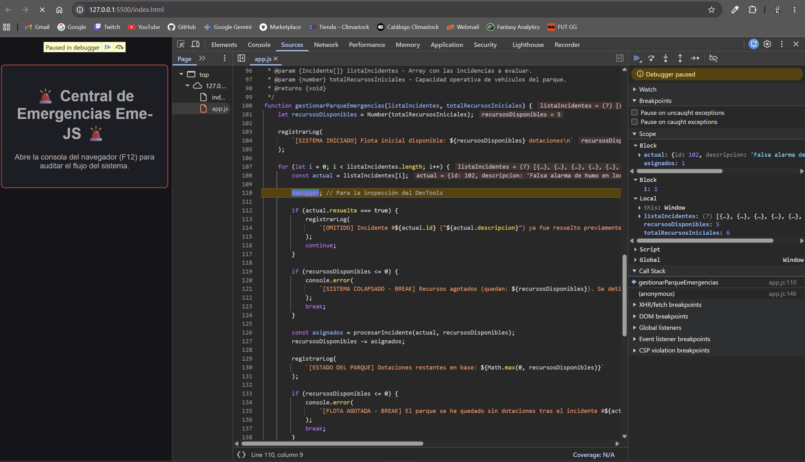

# Eme-JS

**Equipo:** Rubén (Driver inicial) & Adrián (Navigator inicial)  
**Proyecto:** Eme-JS - Sistema de Control de Emergencias  
**Despliegue GitHub Pages:** https://adribarrera.github.io/Eme-JS/

---

### Captura y Análisis de Variables (Debugger)

Durante la ejecución del ciclo principal en `gestionarParqueEmergencias()`, se inserta la instrucción `debugger;` al inicio de cada iteración del bucle `for` para congelar el entorno antes de aplicar los filtros condicionales.

Al pausar en la iteración del incidente ID `102` (`Falsa alarma de humo en local`):
- **Call Stack:** `gestionarParqueEmergencias`
- **Scope:**
  - `i`: `1`
  - `actual`: `{ id: 102, descripcion: "Falsa alarma de humo en local", gravedad: 1, resuelta: true }`
  - `recursosDisponibles`: `5`

**Bugs detectados y resueltos:**  
1. **Variable inexistente o fuera de scope:** En la primera versión se detectó una discrepancia al llamar `garvedadNumerica` en el `switch` en vez de `gravedadNumerica`, lo que provocaba un fallo de ejecución `ReferenceError`.

---

### 👥 Experiencia de Pair Programming

La metodología nos permitió repartir los roles con claridad y asegurar la calidad del código. Mientras Rubén escribió la arquitectura inicial de datos y la estructura del bucle con los operadores de flujo, Adrián supervisaba la coherencia de las condiciones y detectó a tiempo el fallo tipográfico en el switch y la nomenclatura de la variable global de depuración.

En la segunda parte intercambiamos roles: Adrián (Driver) incorporó la documentación estandarizada con bloques JSDoc (`@typedef`, `@param`, `@returns`), la directiva `debugger;` y el workflow de CI/CD para GitHub Pages, mientras Rubén (Navigator) validó la ejecución en las DevTools y supervisó las pruebas de saturación de recursos.